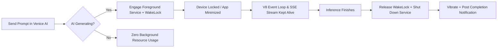

# Venice AI Manager for Android

<p align="center">
  
</p>

<p align="center">
  <strong>Native Android companion for Venice.ai with background stream keep-alive, isolated multi-account sandboxing, and anti-detect privacy protection.</strong>
</p>

<p align="center">
  <a href="https://android.com"></a>
  <a href="LICENSE"></a>
  <a href="https://venice.ai"></a>
  
  
</p>

---

## The Problem with Standard Mobile Browsers

Using **[Venice.ai](https://venice.ai)** inside standard mobile browsers (Chrome, Brave, Firefox) poses two severe limitations on Android:

1. **Background Freezing & Stream Interruption**: When you turn off your screen or switch to another app while Venice AI is generating a complex prompt or rendering an image, Android suspends browser JavaScript timers and network connections. The stream cuts off, the response is lost, and you have to regenerate from scratch.
2. **Account Switching Friction**: Managing separate Venice AI accounts (e.g. personal, work, pro tier, anonymous) requires constantly logging out, entering credentials, solving captchas, and going through 2FA.

**Venice AI Manager** solves these issues with a hardened native Android runtime engineered specifically for high-reliability AI workloads.

---

## Core Capabilities

### ⚡ 1. Task-Bound Background Generation Keeper
- **Active-Only Execution**: The background engine activates **strictly while Venice AI is actively generating responses or rendering media**.
- **Zero Idle Drain**: The moment text streaming or image inference completes, the CPU `PARTIAL_WAKE_LOCK` is released and the Foreground Service stops immediately.
- **Real-Time Stream Observer**: Dual-mode observer (`VeniceJsBridge`) monitors live DOM mutations, button state transitions, and inference API requests with intelligent throttling to prevent rendering micro-stutters.
- **Haptic & Sound Alerts**: Receives real-time push notifications and customizable haptic vibration feedback the second generation finishes.



---

### 🛡️ 2. Hardware-Level Sandboxed Profile Store
- **Multi-Container Isolation**: Powered by modern `androidx.webkit.ProfileStore`. Each account operates inside its own physically isolated Chromium storage container:
  - Separate cookies (`profile.getCookieManager()`)
  - Dedicated `localStorage` & `sessionStorage`
  - Independent `IndexedDB` databases (where Venice stores auth tokens and chat caches)
  - Dedicated HTTP cache and Service Worker controllers
- **Instant 1-Tap Switching**: Switch between profiles in a fraction of a second without logging out or re-entering credentials.
- **Zero Session Bleeding**: Switching profiles cleanly destroys the active renderer and instantiates a pristine WebView bound strictly to the target container.
- **Disk Sanitization**: Deleting an account physically deletes all associated database files and cookies from storage.

---

### 🕶️ 3. Anti-Detect & Stealth Privacy Engine
- **User-Agent Sanitization**: Normalizes User-Agent strings, removing WebView markers (`; wv`, `Version/4.0`, launcher tags) to match standard desktop/mobile Google Chrome.
- **Header Masking**: Automatically suppresses the `X-Requested-With: com.venicelauncher.app` HTTP header via AndroidX allow-lists.
- **Fingerprint Noise**: Injects subtle, profile-seeded deterministic noise into Canvas 2D exports, WebGL vendor/renderer parameters, and AudioContext buffers without distorting on-screen graphics.
- **WebRTC Shield**: Disables WebRTC STUN candidate discovery to prevent local IP leakage.
- **Disposable Incognito Sessions**: Launch temporary guest profiles with a single tap. All cookies, tokens, and profile data are completely purged from disk the moment you switch profiles or close the app.

---

### 📦 4. Live Automatic Backups & 1-Click Restore
- **Custom Folder Binding**: Select any directory on your device (SD Card, Documents, synced Nextcloud/Drive folder) using Android's Storage Access Framework (`OpenDocumentTree`).
- **Standard ZIP Archives**: Exports complete self-contained `.zip` archives containing all profiles, session cookies, and storage snapshots:
  ```text
  venice_backup_YYYY-MM-DD_HH-mm-ss.zip
  ├── manifest.json              # Archive metadata, schema version, profile count
  ├── accounts.json              # Full account profiles payload
  ├── cookies/                   # Raw session cookie dumps per account
  ├── storage/                   # LocalStorage & SessionStorage snapshots per account
  └── README.txt                 # Archive information
  ```
- **Automated Sync & Rotation**: Backs up automatically on profile/cookie changes while keeping the latest 5 timestamped versions.
- **Disaster Recovery**: Automatically scans any folder for valid archives and restores full authentication across all accounts in seconds.

---

### 📱 5. Native Android Ergonomics & UX
- **Snapping Floating Control**: Draggable floating button providing instant access to accounts and settings, automatically snapping to screen edges.
- **Stealth Mode**: Toggle off the floating button entirely and open the control center by long-pressing the device Back button.
- **Predictive Back Navigation**: Fully integrated with Android 13/14 back gesture navigation.
- **Native Download Manager**: Integrated download listener directly enqueues generated images into Android's public `Downloads` directory with system progress bars.
- **File & Camera Chooser**: Supports attaching photos and files directly from camera capture or gallery picker into chat prompts.
- **Venice Dark Aesthetic**: Styled with official Venice.ai color palettes (Deep Sea `#06090D`, Midnight `#0E1217`, and Sand Gold `#BEA989`).

---

## Architecture Overview

```
com.venicelauncher.app/
├── MainActivity.java                 # Core WebView lifecycle, UI orchestration, gesture navigation
├── BackgroundKeepAliveService.java   # Android Foreground Service, WakeLock & completion alerts
├── AccountManager.java               # Containerized profile state, session snapshots & cookie sync
├── AntiDetectManager.java            # UA normalization, fingerprint noise & privacy guard
├── BackupManager.java                # Structured ZIP compression, SAF folder sync & auto-recovery
├── VeniceJsBridge.java               # Low-overhead DOM stream observer & generation detector
└── AccountsAdapter.java              # RecyclerView adapter for quick profile switching
```

---

## Building from Source

### Prerequisites
- **Docker** (recommended for reproducible 1-command builds)
- *Alternatively*: JDK 17, Android SDK (Platform 34, Build Tools 34.0.0)

### 1. Build with Docker (Recommended)
```bash
./build_apk.sh
```
The script compiles, aligns, and signs the release APK inside an isolated Android SDK container. Output will be generated at `./VeniceLauncher.apk`.

### 2. Build with Gradle CLI
```bash
./gradlew assembleRelease
```
The output APK is generated at `app/build/outputs/apk/release/app-release.apk`.

### Run Unit Tests
```bash
./gradlew test
```

---

## Permissions Breakdown

Venice AI Manager requests only the permissions strictly necessary to execute background generation and native Android integrations:

| Permission | Category | Purpose |
|---|---|---|
| `INTERNET` | Network | Connect to Venice AI services |
| `ACCESS_NETWORK_STATE` | Network | Monitor network connectivity transitions |
| `WAKE_LOCK` | System | Keep CPU active during background AI generation |
| `FOREGROUND_SERVICE` | Service | Run background keep-alive process |
| `FOREGROUND_SERVICE_DATA_SYNC` / `SPECIAL_USE` | Service | Android 14 Foreground Service type compliance |
| `POST_NOTIFICATIONS` | UX | Notify when text/image generation finishes in background |
| `VIBRATE` | Haptic | Provide vibration alert on response completion |
| `CAMERA` | Media | Capture photo attachments directly for multimodal prompts |
| `READ_MEDIA_IMAGES` / `READ_EXTERNAL_STORAGE` | Storage | Attach images from device storage |

---

## Security & Privacy Model

- **No Third-Party Analytics**: 0 trackers, 0 external SDKs, 0 telemetry.
- **Direct Connection**: All HTTP/WebSocket traffic travels directly between your device's Chromium engine and `https://venice.ai`.
- **Local Storage Only**: All account sessions, cookies, and backups remain strictly on your local device storage or the folder you designate.
- **Open Source**: Full source code available under Apache 2.0.

---

## License

This project is licensed under the [Apache License 2.0](LICENSE).
Venice AI is a trademark of its respective owners. This application is an independent open-source client.
